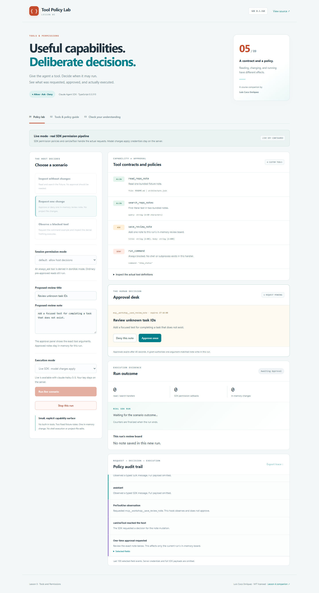

# Lesson 05 · Tool Policy Lab

A hands-on companion to **Claude Agent SDK TypeScript version 0.3.310**, by Luis Coco Enríquez.

Learn **Lesson 5: Tools and Permissions** by separating a capability's contract, its approval policy, and evidence that its handler actually executed. The lab supports local policy exercises and real SDK queries, including a one-time human approval desk.



## Run the application

Requirements: **Node.js 22.14+**, npm, Git, and a browser.

```sh
git clone https://github.com/luiscoco/claude-agent-sdk-lesson-05.git
cd claude-agent-sdk-lesson-05
npm ci
npm run dev
```

Open **http://127.0.0.1:4351**. Local mode works without a model account or API key.

1. Run **Inspect without changes**. Compare the read/search handler count with SDK callback count.
2. Choose **Request one change** in `default` mode. Run it, review the exact note, and choose **Approve once** or **Deny this note**.
3. Repeat with `dontAsk`: the note is denied without opening an approval prompt.
4. Try **Observe a blocked tool**. The command example is denied before handler dispatch.
5. Inspect the audit trail and in-memory review board. Export a trace and complete the quiz.

See [the classroom walkthrough and answer guide](docs/lesson-5-walkthrough.md).

## Four explicit custom capabilities

| Tool                | Contract / effect                                                     | Live SDK policy                                                   |
| ------------------- | --------------------------------------------------------------------- | ----------------------------------------------------------------- |
| `read_repo_note`    | Read only `README.md` or `architecture.json` from the bundled fixture | Ordinary pre-approval through `allowedTools`                      |
| `search_repo_notes` | Literal search in those same two notes                                | Ordinary pre-approval through `allowedTools`                      |
| `save_review_note`  | Add a bounded title/body to this run's in-memory review board         | `always_ask`, plus an independent one-use handler grant           |
| `run_command`       | A prohibited command example; its only input is `show_status`         | `always_deny`; the stub refuses execution even if called directly |

The application never executes a shell command, edits repository files, or persists review notes. The live SDK itself runs its normal subprocess, but no built-in tools are enabled. Notes belong only to the current run and can be preserved by exporting the trace.

## Local mode and live SDK mode are distinct

| Mode      | Actual behavior                                                                                                                                                                                              |
| --------- | ------------------------------------------------------------------------------------------------------------------------------------------------------------------------------------------------------------ |
| **Local** | An explicit host router applies allow/ask/deny, then uses a real MCP client and linked in-memory transport to call the SDK-hosted tools. No SDK query, model request, or SDK `canUseTool` callback executes. |
| **Live**  | A real `query()` with open streaming input exercises SDK permissions, pre-approval, per-tool policies, and the actual `canUseTool` callback. Sending runs makes billable model requests.                     |

Local mode is not a simulation of the complete SDK permission pipeline. It demonstrates application-side routing and real tool execution. The SDK's server policy metadata alone does not protect a raw MCP transport; the handler grant is a separate enforcement layer.

## Configure live mode

Copy `.env.example` to `.env`, add **your own** `ANTHROPIC_API_KEY`, and restart the server. In PowerShell:

```powershell
Copy-Item .env.example .env
```

Optionally set `ANTHROPIC_MODEL` to an available account model. The key stays on the Node.js server. `.env` and `.local` are ignored by Git, and browser metadata contains only availability and a model name.

Choose **Live SDK · model charges apply**. Repeat all three scenarios and both approval decisions. All five live cases have been manually verified; see [the live verification record](docs/live-verification.md).

An SDK warning named `CLAUDE_SDK_CAN_USE_TOOL_SHADOWED` is expected for this sample's two pre-approved read tools. It explains the lesson: those calls skip `canUseTool`. The note tool is not pre-approved; its explicit policy requires the decision path in `default` mode.

## The version-correct tool contract

In **0.3.310**, the helper takes positional arguments:

```ts
tool(name, description, rawZodShape, async handler, extras?);
```

The handler receives validated arguments and returns an MCP envelope with `content`, optional `structuredContent`, and optional `isError`. The lesson's conceptual `tool({ name, execute, ... })` example is not the callable signature in this pinned version. Read the complete runnable definitions in [tools.ts](src/server/tools.ts).

The schema defines valid input. The handler performs work. An annotation describes behavior. Permission policy and host approval are separate responsibilities.

## Put policy on the correct surface

```ts
const server = {
  ...createSdkMcpServer({ name: 'tool-policy-workshop', tools: appTools }),
  tools: [
    { name: 'save_review_note', permission_policy: 'always_ask' as const },
    { name: 'run_command', permission_policy: 'always_deny' as const },
  ],
};
```

The two `tools` arrays above serve different purposes: the first holds definitions passed to the factory; the returned config's array holds policy entries. Register that config under `mcpServers.workshop`. A query tool name becomes `mcp__workshop__save_review_note`.

- Root `options.tools` chooses available **built-in** tools. This lab sets it to `[]`.
- `allowedTools` auto-approves named calls. It does not remove other capabilities and does not guarantee callback execution.
- `canUseTool` handles permission requests that reach the host. It checks the expected tool, SDK provenance, and valid note arguments before opening approval.
- In this app's `default` mode, `always_ask` reaches the host decision path. In `dontAsk`, it is denied without prompting.
- `always_deny` blocks the command example before its handler. The app does not load project/user settings or plugins.
- The pinned SDK documents only `always_ask` and `always_deny` as effective for SDK-hosted server policy entries. This sample does not treat `always_allow` as supported enforcement there.
- `PreToolUse` is used for observation here. It returns no allow decision. A hook can enforce checks for every call in a broader host, including calls that skip `canUseTool`.

Other permission modes and installed configuration can change the wider evaluation pipeline. This app deliberately exposes only `default` and `dontAsk`; it does not claim to reproduce every SDK policy interaction.

## One-time approval is bound to a concrete action

The [approval broker](src/server/approvals.ts) creates a random request ID inside the current run and copies the exact title/body. It accepts only **approve once** or **deny**. A decision cannot change the arguments, grant a different tool, approve another run, or be replayed.

An approval issues one grant matching that note's normalized arguments. The note handler independently consumes the grant before changing memory. A direct MCP call without a grant returns `isError` and changes nothing. Two identical requests still need two grants to create two notes.

Pending requests expire after **45 seconds**. Run abort, permission callback abort, shutdown, and cleanup resolve pending requests as denials. At most four approvals can be pending, and closing the run invalidates unused grants. Review-board mutations are synchronous after grant consumption; already completed changes are not undone by later cancellation.

## Evidence students can explain

| Scenario       | Expected evidence                                                                                                                                              |
| -------------- | -------------------------------------------------------------------------------------------------------------------------------------------------------------- |
| Read/search    | Read and search handlers execute; no mutation. Live pre-approved reads do not call `canUseTool`.                                                               |
| Approved note  | Live callback reaches the host, learner approves, save handler runs, one note is added. Local mode uses its router and therefore still has zero SDK callbacks. |
| Declined note  | Approval is denied; save handler stays at zero.                                                                                                                |
| `dontAsk` note | No approval panel; zero callback and save-handler calls.                                                                                                       |
| Command denial | Command-handler count remains zero. A successful final SDK answer can explain the tool denial.                                                                 |

Counters are final report snapshots, not billing or permission guesses. If a connection fails before the final report, the UI marks counts as unknown. An interrupted stream does not prove no handler executed.

The guide also groups actual installed built-in names into files, search, commands, and task tracking. Compile-checked inventory examples are in [builtin-recipes.ts](src/examples/builtin-recipes.ts). Those examples are not executed by the live lab. `cwd` and a tool inventory do not establish an OS sandbox.

## Boundaries and cleanup

This is a single-run local teaching host bound to `127.0.0.1`. Multiple tabs share the current run. Requests use same-origin JSON checks and server-side validation. The browser cannot submit arbitrary shell commands, file paths, plugin settings, tool definitions, or API keys.

The read tool uses fixed names and real-path containment. Search is literal. The command stub contains no process execution code. Read-only annotations are metadata, not security boundaries. The live environment forwards necessary platform/auth values rather than every unrelated server variable.

Live queries configure **6 turns**, an estimated **$0.25 budget**, a **120-second host timeout**, disabled persistence, and isolated ignored SDK state under `.local/sdk-state`. All query handles, MCP transports, queues, pending approvals, unused grants, listeners, and timers are released on completion, failure, or cancellation.

## CLI and checks

```sh
npm run policy:cli  # local host router + real MCP; no model
npm run api:check   # pinned installed package check
npm run check       # types, unit/API tests, production build
```

Optional real model verification using your own key:

```sh
npm run live:smoke          # read-only live case
npm run live:smoke -- --all # five live cases, including explicit approval test drivers
```

The `--all` test driver approves or declines only its own in-memory note requests. It does not enable automatic approval in the application UI. Each run configures a $0.25 estimated budget. Automated CI tests use real local MCP and injected query handles instead of model requests.

For production: `npm run build`, then `npm start`. Browser tests build and start a separate server on **4352**:

```sh
npx playwright install chromium
npm run test:e2e
```

On Linux, use `npx playwright install --with-deps chromium` if needed. GitHub Actions checks Node.js 22/24 and Chromium.

## Source map and references

- [tools.ts](src/server/tools.ts): actual SDK tool contracts, bounded handlers, and server policy metadata.
- [approvals.ts](src/server/approvals.ts): exact-action one-time approvals, expiry, cancellation, and grant consumption.
- [runner.ts](src/server/runner.ts): local routing, live streaming query, callback, observation hook, counters, and cleanup.
- [app.ts](src/server/app.ts): run and decision HTTP routes, concurrency, and SSE events.
- [docs/lesson-5-walkthrough.md](docs/lesson-5-walkthrough.md): classroom sequence and answers.
- [Official permissions guide](https://code.claude.com/docs/en/agent-sdk/permissions), [custom tools guide](https://code.claude.com/docs/en/agent-sdk/custom-tools), and [SDK 0.3.310 release](https://github.com/anthropics/claude-agent-sdk-typescript/releases/tag/v0.3.310).
- Installed `sdk.d.ts` declarations for `tool`, `McpServerToolPolicy`, `Options`, `CanUseTool`, and `SDKResultMessage`.

Online documentation evolves; this sample's contract is the pinned package. Previous sample: [Lesson 4 Configuration Studio](https://github.com/luiscoco/claude-agent-sdk-lesson-04).

MIT © Luis Coco Enríquez. Independent educational sample; not an official Anthropic product.
